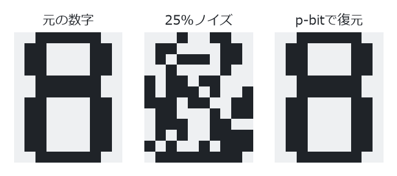
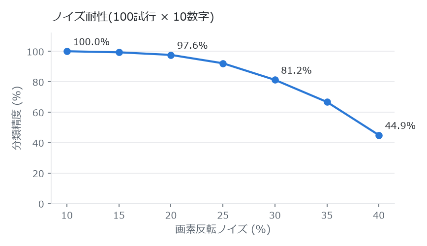

# pbit-engine — 確率的ビット(p-bit)画像認識エンジン

p-bit(probabilistic bit)による連想記憶型の画像認識エンジン。外部依存なし、C++23単体。

<picture>
  <source media="(prefers-color-scheme: dark)" srcset="docs/recall-dark.png">
  
</picture>

*25% の画素を反転させた「8」を、p-bit ネットワークのアニーリングで元の形に復元(`demo.exe` の出力)*

## p-bitとは

量子ビットが重ね合わせ状態を持つのに対し、p-bitは **0/1の間を高速に揺らぎ続ける古典ビット**(Camsari らが提唱)。更新則は1行:

```
m_i = sgn( tanh(β·I_i) − r ),   r ~ U(−1,1),   I_i = Σ_j J_ij·m_j + h_i
```

- β→0: 完全ランダム(重ね合わせの古典アナログ)
- β→∞: 決定的なHopfieldダイナミクス(観測・収束のアナログ)
- βを徐々に上げる = **シミュレーテッド・アニーリング**(量子アニーラと同型の問題設定: Isingエネルギー最小化)

## 認識の仕組み

1. **学習**: 10種の数字ビットマップ(10×12=120画素, ±1)を擬似逆行列則で結合行列 J に格納。全パターンが厳密な固定点になる
2. **証拠注入**: ノイズ画像をバイアス場 h_i = λ·noisy_i として与える(事前分布=J、尤度=h のベイズ推論)
3. **アニーリング**: β 1.0→6.0 でGibbsサンプリング。熱ゆらぎがスプリアス状態からの脱出を担う
4. **凍結**: 証拠を線形減衰させつつ冷却 → 純粋な記憶パターンへ緩和
5. **分類**: 格納パターンとのオーバーラップ最大の数字を出力

## 結果(100試行×10数字)


<picture>
  <source media="(prefers-color-scheme: dark)" srcset="docs/accuracy-dark.png">
  
</picture>

| 画素反転ノイズ | 分類精度 | 復元オーバーラップ |
|---|---|---|
| 10% | 100.0% | 1.000 |
| 20% | 97.6% | 0.993 |
| 25% | 92.1% | 0.984 |
| 30% | 81.2% | 0.960 |
| 40% | 44.9% | 0.793 |

## 使い方

```bat
build.bat        rem g++ (MinGW-w64) でビルド
demo.exe         rem 学習→ノイズ付加→復元→分類、精度表を出力
test_pbit.exe    rem 不変条件テスト4種
```

## ファイル

- `pbit.hpp` — p-bitネットワーク本体(更新則、エネルギー、アニーリング)
- `patterns.hpp` — 数字ビットマップ、擬似逆行列学習、証拠バイアス付き想起、分類
- `demo.cpp` / `test_pbit.cpp` — デモ / テスト

## 設計メモ

- 数字パターン同士の相関が高い(0と8のオーバーラップ0.80など)ため、Hebbian則ではなく**擬似逆行列則**が必須
- 高温スタート(β<1)は入力画像の情報を消して失敗する。**証拠バイアス λ=0.6** が想起中の情報消失を防ぐ(実測: バイアスなしβ1.0開始 10% → バイアスあり 97.6%)
- 凍結時に証拠を即座に切ると相関する別数字の谷へ滑る(95.3%)。**線形減衰**が精度と復元品質を両立(97.6%, overlap 0.993)

## ライセンス

[MIT License](LICENSE) © 2026 purplecatman2005-dev
